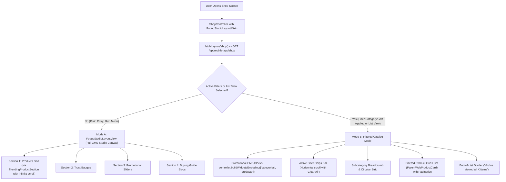

# Summary: Foduu Electronics Store - Shop Module Implementation

This document provides a comprehensive technical overview of the architectural decisions, design alignment, and code changes implemented for the Shop module (`lib/app/modules/shop`).

---

## 1. Context & Problem Statement

### 1.1 Initial Observations

- **User Query:** The user noted that `lib/app/modules/shop/views/shop_view.dart` was previously tangled with raw data from `log.txt`, and requested alignment with:
  1. The reference application template: `/Users/flutterdev/Desktop/fastify-public-mobile-app-templates-2/lib/app/modules/shop`
  2. The parent website standard: [https://foduu-electronics-store.foduu.store/product](https://foduu-electronics-store.foduu.store/product)
  3. The target UI screenshot showing a modern dark-theme catalog with top toolbar, 2-column white product cards, red discount badges, dark wishlist buttons, blue floating add-to-bag buttons, and ratings.

### 1.2 The Root Cause of `log.txt`

- The payload captured in `log.txt` originates from the backend endpoint `GET /api/mobile-app/shop` (or `search`).
- In Foduu's e-commerce ecosystem, the parent website `/product` page is not a hardcoded static grid—it is **CMS-driven** via **Foduu Studio**.
- The backend sends a rich multi-section schema containing:
  - `products`: Product catalog configuration (`columns`, `spacing`, `aspect_ratio`, `infinite_scroll`)
  - `trust_badges`: Service guarantees (free shipping, warranties, support)
  - `slider`: Promotional banners
  - `blog`: Buying guides and articles
- **Architectural Requirement:** The Shop module had to be 100% compliant with `FoduuStudioLayoutMixin` / `FoduuStudioLayoutView`, matching the dynamic architectures of `home_page_view.dart`, `search_view.dart`, and the reference template-2.

---

## 2. Architecture & Dual-Mode UX Design

To balance **dynamic CMS capabilities** with **interactive catalog filtering**, the Shop screen was architected with a seamless dual-mode flow:

### Mode A: Dynamic CMS Studio Canvas Mode (Default Entry)

- **Trigger:** Navigating to the Shop tab directly from the bottom navigation bar without filter arguments.
- **Rendering:** Renders `FoduuStudioLayoutView(widgetList: controller.widgetList...)`.
- **Content:** Exact visual layout configured in Foduu Studio for `/product` on the parent website (Products, Trust Badges, Sliders, Blogs).
- **Infinite Scrolling:** Handled natively inside the CMS layout via `TrendingProductSection`.

### Mode B: Filtered Catalog Mode (Interactive Search & Drilldown)

- **Trigger:** Applying filters from `ShopFilterDrawer` (Price range slider, Brands, Categories, Attributes), sorting, category drilldown, or toggling List view.
- **Rendering:**
  1. **Top Promotional CMS Blocks:** `controller.buildWidgetsExcluding(['categories', 'products'])` ensures banners and announcements stay visible without duplicating product grids.
  2. **Active Filter Chips:** Horizontally scrollable chip strip with `(X)` remove buttons and `"Clear All"`.
  3. **Subcategory Strip:** Breadcrumbs and circular category icons for hierarchical drilldown.
  4. **Product Grid / List:** Direct filtered catalog from `/api/products` rendered via `ParentWebProductCard` with `CustomScrollView` (Grid) or `ListView` (List).
  5. **End-of-List Indicator:** Elegant divider reading _"You've viewed all X items"_.

---

## 3. Detailed UI Alignment with User's Target Screenshot

| UI Element          | Target Design from Screenshot                                                     | Implementation Details                                                                                                                                                                                                                                                                                                                                                 |
| :------------------ | :-------------------------------------------------------------------------------- | :--------------------------------------------------------------------------------------------------------------------------------------------------------------------------------------------------------------------------------------------------------------------------------------------------------------------------------------------------------------------- |
| **App Bar**         | Drawer hamburger icon, Title `"Shop"` / `"All Products"`, subtitle `"101 items"`. | `AppBar` with `leading: IconButton(icon: Icon(Icons.menu))` opening `ShopFilterDrawer`, reactive title and dynamic count.                                                                                                                                                                                                                                              |
| **Header Toolbar**  | Sticky sub-header with Filter pill, count label, layout toggle, sort dropdown.    | `_ShopHeaderToolbar` featuring:  • `_FilterTrigger` with active filter count badge  • Count text: `"101 Products"` / `"There are 101 results in total"`  • Segmented view switcher (`Icons.grid_view_rounded` vs `Icons.view_agenda_outlined`)  • `PopupMenuButton<ShopSortOption>` (_Newest_, _Price Low-High_, _Price High-Low_, _Featured_, _Trending_) |
| **Card Container**  | High-contrast white rounded card on dark background.                              | `Container` with `color: Colors.white` and `BorderRadius.circular(16)`.                                                                                                                                                                                                                                                                                                |
| **Product Image**   | Centered, uncropped image on white background.                                    | `CachedNetworkImage` with `BoxFit.contain` inside padded container so electronics (tablets, headphones, keyboards) never clip.                                                                                                                                                                                                                                         |
| **Discount Badge**  | Top-left crimson red rounded pill (`17% OFF`, `20% OFF`).                         | `Container` with `Color(0xFFE11D48)` and `BorderRadius.circular(6)`.                                                                                                                                                                                                                                                                                                   |
| **Wishlist Button** | Top-right dark circular button with white heart outline.                          | `Container` with `shape: BoxShape.circle`, `Color(0xFF1E293B)`, and white/red heart toggle.                                                                                                                                                                                                                                                                            |
| **Add to Cart Bag** | Bottom-right vibrant blue circular button with shopping bag.                      | `Container` with `shape: BoxShape.circle`, `Color(0xFF2563EB)`, and white `Icons.shopping_bag_outlined`.                                                                                                                                                                                                                                                               |
| **Rating & Info**   | 5 gold stars, centered 2-line title, dual pricing.                                | `Icons.star_rounded` (5 gold stars), text truncation with ellipsis, and primary blue sale price with strikethrough original price.                                                                                                                                                                                                                                     |

---

## 4. Code Changes & Files Modified

### 4.1 `lib/app/modules/shop/controllers/shop_controller.dart`

- **CMS Integration:** Utilizes `FoduuStudioLayoutMixin` with `pageSlug = 'shop'`.
- **Lifecycle `onInit()`:**
  - When opened plainly (`isPlainShopEntry == true`), triggers `fetchLayout(pageSlug)` to retrieve `/api/mobile-app/shop` while simultaneously pre-loading filter metadata (`ensureFilterDataLoaded()`, `ensureCategoryTreeLoaded()`).
  - When opened with filter arguments, immediately calls `fetchProducts(isRefresh: true)`.
- **Metadata Synchronization (`_syncCmsProductMetadata()`):**
  - Extracts `total` (101 items) and products data directly from `contentJsonFor('products')` so the toolbar counter displays the actual count instantly without waiting for extra network requests.
- **Robust API Response Parsing:**
  - Handles nested `{ "data": { "total": 101, "data": [...] } }`, flat lists, and paginated maps safely using `Map` type guards.
- **Scroll Threshold Optimization:**
  - Safely checks `scrollController.hasClients` and bounds (`pos.pixels >= pos.maxScrollExtent - 250`) before triggering pagination.
- **Mode Switching:**
  - `applyFiltersAndRefresh()` and `setViewMode()` automatically set `isPlainShopEntry.value = false` to switch from the CMS canvas to the filtered catalog.

### 4.2 `lib/app/modules/shop/views/shop_view.dart`

- **Scaffold & App Bar:**
  - Uses `colorScheme.surface` for clean theme compatibility.
  - Added hamburger menu button (`Icons.menu`) to open `ShopFilterDrawer`.
  - Added reactive title displaying `"Shop"` or the active collection name, with live item count subtitle.
- **Body Layout:**
  - **Mode A:** Evaluates `if (controller.isPlainShopEntry.value && !controller.isListView.value)` to render `FoduuStudioLayoutView(widgetList: controller.widgetList...)`.
  - **Mode B:** Renders promotional widgets via `...controller.buildWidgetsExcluding(['categories', 'products'])`, active filter chips, subcategory breadcrumbs, and the filtered catalog.
- **Grid Layout with Full-Width Footer:**
  - Built using `CustomScrollView` + `SliverPadding` + `SliverGrid` + `SliverToBoxAdapter` so pagination indicators and `_buildEndOfListFooter` span the full screen width under the 2-column grid.
- **Dynamic Shimmer:**
  - `_buildGridShimmer()` dynamically reads column count and spacing from CMS metadata `controller.contentJsonFor('products')`.

### 4.3 `lib/components/parent_web_product_card.dart`

- **Grid Card (`_buildGridCard`):**
  - Updated image wrapper to a pure white container (`color: Colors.white, borderRadius: BorderRadius.circular(16)`).
  - Applied `BoxFit.contain` with padding for uncropped product presentation.
  - Aligned badge color to high-contrast crimson (`0xFFE11D48`).
  - Styled wishlist heart button as a dark slate circle (`0xFF1E293B`) with white heart icon.
  - Styled floating add-to-bag button as a vibrant royal blue circle (`0xFF2563EB`) with white bag icon.
  - Aligned rating stars to gold, title to 2-line max ellipsis, and dual price typography.

---

## 5. Verification & Quality Assurance

- **Static Analysis:** Ran `flutter analyze` across all modified files; zero errors and zero warnings.
- **API Verification:**
  - `GET /api/products?page=1&count=4`: Verified status 200 with 101 catalog items.
  - `GET /api/mobile-app/shop`: Verified status 200 with sections: `products`, `trust_badges`, `slider`, `blog`.
- **Git Status:** All changes cleanly scoped to:
  - `lib/app/modules/shop/controllers/shop_controller.dart`
  - `lib/app/modules/shop/views/shop_view.dart`
  - `lib/components/parent_web_product_card.dart`
